<p align="center">
  
</p>

<p align="center">
  Gerenciador operacional de propostas de shows e eventos de Hip Hop.
</p>

<p align="center">
  
  
  
  
</p>

---

## Sobre o projeto

O **Urban Booking** organiza as propostas de contratação de shows de Hip Hop num só lugar. É feito para **produtores de eventos, agentes artísticos e managers**, que negociam vários shows ao mesmo tempo e precisam saber, de forma rápida, o que está pendente, o que foi confirmado e quanto cada show vale.

Cada proposta registra **quem vai tocar, quem está contratando, onde, quando, por quanto** e **em que situação** a negociação está.

> Projeto individual da disciplina **Programação Front-End 01**: front-end em Next.js integrado a uma API Node.js com Express e dados em memória.

## O que o site faz

### Painel inicial
- Saudação de acordo com o horário (bom dia, boa tarde, boa noite).
- **Cartaz do próximo show:** destaca a próxima proposta com data futura que não foi cancelada, com a data, o artista em letras grandes e o local.
- **Situação das propostas:** quantas estão pendentes, confirmadas e canceladas, e o total em cachês confirmados.

### Agenda de propostas
- Lista no estilo de cartaz de turnê, **ordenada pela data do show**.
- **Filtros por situação** (Todas, Pendente, Confirmado, Cancelado), com a contagem de cada uma.
- Cada linha mostra a data, o artista, a categoria, o contratante, o local, o cachê e a situação. Um clique na linha abre os detalhes.

### Detalhes da proposta
- Visual de **ingresso**: o nome do artista em destaque e as informações separadas em *quando*, *onde* e *cachê*.
- Botões para **editar** e **excluir** a proposta.

### Cadastro e edição
- Formulário com todos os campos, validação dos campos obrigatórios e mensagens claras de sucesso ou erro.
- Na edição, o formulário já vem preenchido e permite mudar a situação (por exemplo, de *Pendente* para *Confirmado*).

### Interface
- Funciona no computador e no celular (grid do Bootstrap).
- Paleta própria e tipografia de cartaz (Bebas Neue + Work Sans).

| Cor | Hex | Uso |
|---|---|---|
| Dark coffee | `#432818` | header, texto principal |
| Dark wine | `#6f1d1b` | botões, nome dos artistas, status confirmado |
| Chocolate brown | `#99582a` | textos secundários |
| Camel | `#bb9457` | bordas tracejadas, status pendente |
| Light apricot | `#ffe6a7` | textos sobre fundos escuros, destaques |

## Dados de uma proposta

| Campo | Obrigatório | Descrição |
|---|---|---|
| `id` | gerado | identificador numérico criado pela API |
| `artista` | sim | rapper, grupo ou atração principal |
| `contratante` | sim | festival, casa de show, produtora ou prefeitura |
| `categoria` | sim | Rap, Trap, Boom Bap, Drill, R&B, Funk ou Batalha de Rima |
| `descricao` | não | observações sobre o show |
| `local` | sim | nome do lugar ou casa de show |
| `cidade` | sim | cidade do evento |
| `estado` | sim | sigla da UF (ex.: SP) |
| `valor` | sim | cachê em reais |
| `data` | sim | data do show |
| `status` | não | Pendente (padrão), Confirmado ou Cancelado |

## Como rodar

**Requisito:** [Node.js](https://nodejs.org/) 20 ou mais recente.

**1. Back-end (API)**
```bash
cd backend
npm install
cp .env.example .env
npm start
```
A API sobe em `http://localhost:3005`.

**2. Front-end (site)**, em outro terminal:
```bash
cd frontend
npm install
npm run dev
```
Abra **http://localhost:3000** no navegador.

> Os dados ficam em memória: ao reiniciar a API, a lista volta para as 10 propostas de exemplo.

## Tutorial de uso

1. **Abra o painel** em `http://localhost:3000`. O cartaz mostra o próximo show e o quadro ao lado resume a situação das propostas.
2. **Veja as propostas** pelo link *Propostas* no topo. Use os filtros para ver só as pendentes, as confirmadas ou as canceladas.
3. **Cadastre uma proposta** em *Nova proposta*. Preencha artista, contratante, categoria, data, local, cidade, estado e valor (a descrição é opcional) e clique em **Salvar proposta**. Se faltar algum campo, aparece uma mensagem dizendo o que corrigir.
4. **Abra os detalhes** clicando em qualquer linha da lista.
5. **Edite** pelo botão **Editar proposta**. Mude o que precisar, como a situação para *Confirmado*, e clique em **Salvar alterações**.
6. **Exclua** pelo botão **Excluir proposta** na página de detalhes. A exclusão é imediata.

## API

Base: `http://localhost:3005/api`

| Método | Rota | O que faz |
|---|---|---|
| GET | `/propostas` | lista todas as propostas |
| GET | `/propostas/:id` | busca uma proposta |
| POST | `/propostas` | cadastra uma proposta |
| PUT | `/propostas/:id` | atualiza uma proposta (aceita só os campos alterados) |
| DELETE | `/propostas/:id` | exclui uma proposta |
| GET | `/check` | confere se a API está no ar |

Respostas de erro: `400` para dados inválidos, `404` para proposta não encontrada e `500` para falha interna.

Exemplo de cadastro:
```json
{
  "artista": "Orochi",
  "contratante": "Mainstreet Records",
  "categoria": "Trap",
  "local": "Arena Jockey",
  "cidade": "Rio de Janeiro",
  "estado": "RJ",
  "valor": 90000,
  "data": "2027-01-09"
}
```

## Estrutura

```
UrbanBooking/
├── backend/                 API Express
│   ├── routes/              rotas /api/propostas
│   ├── controllers/         respostas HTTP e erros
│   ├── services/            regras (validação, atualização parcial)
│   ├── models/              classe Proposta e dados em memória
│   └── server.js / app.js
└── frontend/                site Next.js (App Router)
    ├── public/logo.svg
    └── src/
        ├── app/             páginas: /, /propostas, /propostas/[id], /propostas/[id]/editar, /nova-proposta
        ├── components/      CardProposta, FormEditar, BotaoExcluir
        └── opcoes.js        categorias e estados
```
